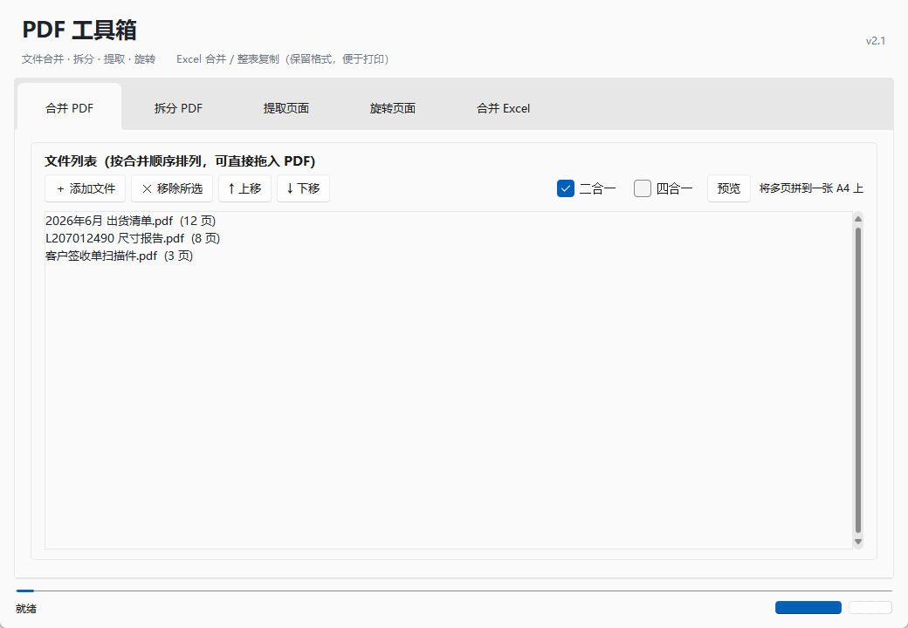
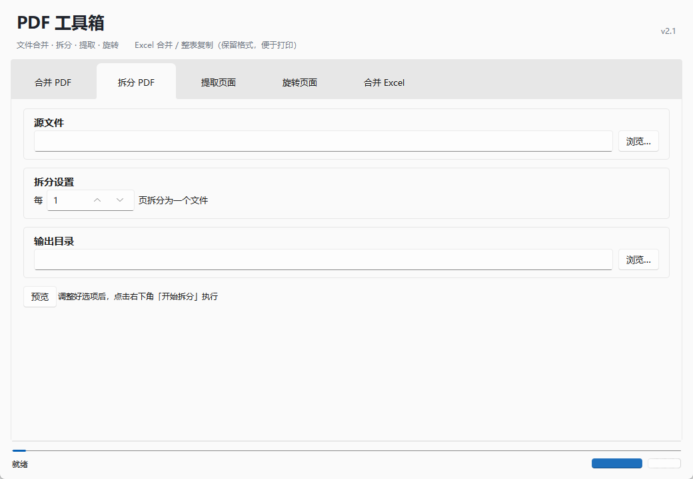
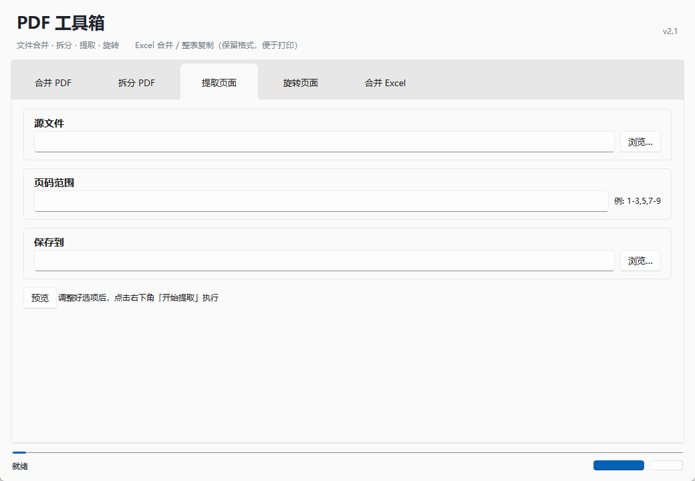
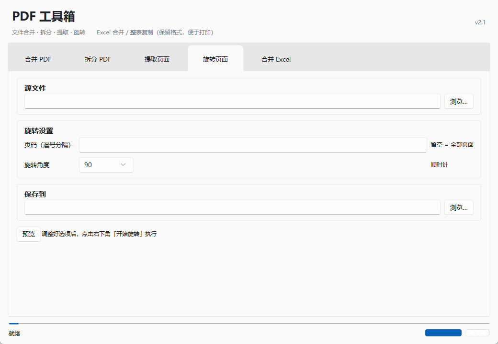
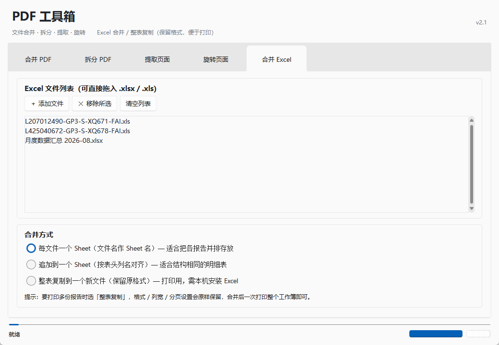

# PDF 工具箱

一个面向日常办公的 Windows 桌面小工具，把常用的 PDF 处理与 Excel 合并集中在一起，带图形界面、支持拖拽、批量处理与实时进度。

- **版本**：v2.2
- **作者**：程鹏昊 · 603381208@qq.com
- **平台**：Windows 10 / 11（64 位）

---

## 功能特性

### PDF

| 功能 | 说明 |
| --- | --- |
| **合并 PDF** | 多个 PDF 按列表顺序合并为一个文件；支持「二合一 / 四合一」A4 拼版（每 2 页或 4 页排在一张 A4 上，适合省纸打印） |
| **拆分 PDF** | 按「每 N 页拆分为一个文件」批量拆分，输出到指定目录 |
| **提取页面** | 按页码范围提取，如 `1-3,5,7-9` |
| **旋转页面** | 指定页码（或留空表示全部）旋转 90° / 180° / 270° |
| **预览** | 独立预览窗口，合并前可先看源页与拼版效果 |

### Excel

| 合并方式 | 说明 |
| --- | --- |
| **每文件一个 Sheet** | 每个文件的所有 Sheet 依次写入新工作簿，Sheet 名取自文件名（自动去重、截断到合法长度） |
| **追加到一个 Sheet** | 所有文件的数据行追加到同一张表，自动按表头列名对齐 |
| **整表复制（保留原格式）** | 调用本机 Excel 把每个文件的全部 Sheet **原样复制**进一个新工作簿：字体、边框、列宽、行高、数字格式、合并单元格、页面设置全部保留。**打印多份报告请用这个模式** |

- 支持 `.xlsx` / `.xls`（`.xls` 通过 xlrd 读取）
- 合并过程有**实时进度**（第几个文件、已处理行数），可**随时取消**
- 大文件采用流式读写，内存占用恒定

### 通用

- 文件列表支持**拖拽**添加、移除、排序
- 浅色现代界面（基于 sv-ttk 主题）
- 后台线程执行任务，界面不卡死；执行按钮显示当前操作名称，支持取消
- 完成后自动提示保存位置

---

## 界面截图

| 合并 PDF | 拆分 PDF |
| --- | --- |
|  |  |

| 提取页面 | 旋转页面 |
| --- | --- |
|  |  |

| 合并 Excel |
| --- |
|  |

---

## 环境要求

- **Windows 10 / 11（64 位）**
- **Python 3.10+**（自带 tkinter）
- **Microsoft Excel**（仅「整表复制（保留原格式）」模式需要，Excel 2007 及以上均可）
- 依赖见 `requirements.txt`

---

## 快速开始

### 1. 源码运行

```bat
python -m pip install -r requirements.txt
python main.py
```

> 如果本机没有安装 Excel，或未安装 `pywin32`，「整表复制」模式会给出明确提示，其余功能不受影响。

### 2. 打包为单个 exe

```bat
python -m pip install -r requirements.txt
pyinstaller --onefile --windowed --name PDFToolbox --clean --collect-data sv_ttk main.py
```

产物在 `dist\PDFToolbox.exe`，可自行改名为 `PDF工具箱.exe`。

> `--collect-data sv_ttk` 不能省略：sv-ttk 主题需要把 `.tcl` / 图片资源一起打进包，否则界面会退回系统默认样式。

`build.bat` 是历史打包脚本（文件编码为 GBK，脚本内的 exe 名称含中文），如需直接使用请确认控制台编码与名称无误；更推荐上面的命令。

> **关于单文件版启动速度**：PyInstaller onefile 每次启动都要把约 50 MB 的包解压到临时目录，再经杀毒软件扫描，通常需要 3~8 秒，属正常现象。想更快可以：
> 1. 改用 `--onedir` 文件夹版（启动可降到 1 秒左右，分发时整个文件夹打包）；
> 2. 打包时排除未使用的模块（如 `--exclude-module numpy`），减小体积；
> 3. 将 exe 所在文件夹加入杀毒软件排除项。

---

## 使用说明

### 合并 PDF

1. 拖拽或点击「＋ 添加文件」加入 PDF（可多选）；
2. 用「↑ 上移 / ↓ 下移」调整合并顺序，或「✕ 移除所选」删除；
3. 需要省纸打印时可勾选「二合一 / 四合一」（两者互斥，仅对合并生效）；
4. 点「预览」确认效果；
5. 点右下角「**开始合并**」，选择保存位置即可。

### 拆分 PDF

1. 选择源 PDF；
2. 填写「每 N 页拆分为一个文件」；
3. 选择输出目录；
4. 点「**开始拆分**」。

### 提取页面

1. 选择源 PDF；
2. 填写页码范围（示例：`1-3,5,7-9`）；
3. 选择保存位置；
4. 点「**开始提取**」。

### 旋转页面

1. 选择源 PDF；
2. 填写要旋转的页码（逗号分隔，留空表示全部）；
3. 选择角度（90 / 180 / 270，顺时针）；
4. 选择保存位置；
5. 点「**开始旋转**」。

### 合并 Excel

1. 把 `.xlsx` / `.xls` 拖入列表，或点击「＋ 添加文件」；
2. 选择合并方式（见上文「Excel」表格）；
3. 点「**开始合并 Excel**」，选择保存路径。

**三种模式怎么选？**

- 只是要汇总数据 → 选「每文件一个 Sheet」或「追加到一个 Sheet」；
- **要打印** → 选「整表复制（保留原格式）」，合并后一次打印整个工作簿，版面与源文件一致。

> 注意：「每文件一个 Sheet」和「追加到一个 Sheet」只复制单元格的**值**，不会保留字体、列宽、数字格式、合并单元格等格式（公式也只取计算结果）。需要保留格式请使用「整表复制」。

---

## 实现说明（简要）

- **PDF 操作**：PyMuPDF（`fitz`）负责合并、拆分、提取、旋转与预览渲染。
- **Excel 数据合并**：`read_only` 读取源文件 + `write_only` 流式写入目标文件，内存占用恒定；`.xls` 使用 xlrd 读取；合并过程按批回调进度、按检查点响应取消。
- **Excel 整表复制**：通过 `win32com` 调用本机 Excel（COM）逐表复制，天然保留全部格式；每个文件/Sheet 之间可取消。
- **界面**：tkinter + ttk + sv-ttk 主题；耗时任务在后台线程运行，主线程只负责界面更新。

---

## 项目结构

```
pdf/
├─ main.py            # 程序入口
├─ gui.py             # 图形界面（tkinter + sv-ttk）
├─ pdf_ops.py         # PDF 操作逻辑（PyMuPDF）
├─ excel_ops.py       # Excel 合并逻辑（openpyxl / xlrd / Excel COM）
├─ preview.py         # PDF 预览窗口
├─ requirements.txt   # 依赖清单
├─ build.bat          # PyInstaller 打包脚本（历史脚本）
├─ docs/              # 设计文档、界面截图
│  ├─ images/         # README 用截图
│  └─ superpowers/    # 早期设计与实现计划
└─ dist/              # 打包产物（PDF工具箱.exe）
```

---

## 常见问题（FAQ）

**Q：双击 exe 后要等好几秒才出窗口，正常吗？**
正常。单文件版每次启动都会先解压约 50 MB 的依赖到临时目录，再经过杀毒软件扫描。可通过改文件夹版、排除无用模块、加白名单等方式改善，详见上文「关于单文件版启动速度」。

**Q：为什么合并后的 Excel 格式全没了？**
「每文件一个 Sheet」和「追加到一个 Sheet」是数据合并，只保留单元格的值；如需保留格式（打印场景），请选「整表复制（保留原格式）」。

**Q：提示「无法用 Excel 打开文件」或「整表复制需要 pywin32」？**
确认本机已安装 Microsoft Excel；源码运行时执行 `python -m pip install pywin32`；如果文件正被 Excel 打开且被独占，先关闭该文件再试。

**Q：.xls 旧格式能合并吗？**
可以。数据合并通过 xlrd 读取 `.xls`；整表复制直接交给 Excel 打开，不受格式限制。

**Q：合并很慢或看起来卡住？**
Excel 合并速度主要受 openpyxl 读写性能限制（大文件可能耗时数分钟），界面会实时显示「第几个文件 / 已处理多少行」，并且随时可以点「取消」。PDF 合并则快得多。

**Q：保存时提示文件被占用？**
输出的目标文件正在被其它程序（如 Excel/PDF 阅读器）打开，关闭后再执行即可。

---

## 作者

**程鹏昊** · 603381208@qq.com

如需开源协议或二次分发约定，可另行补充（例如 MIT License）。
